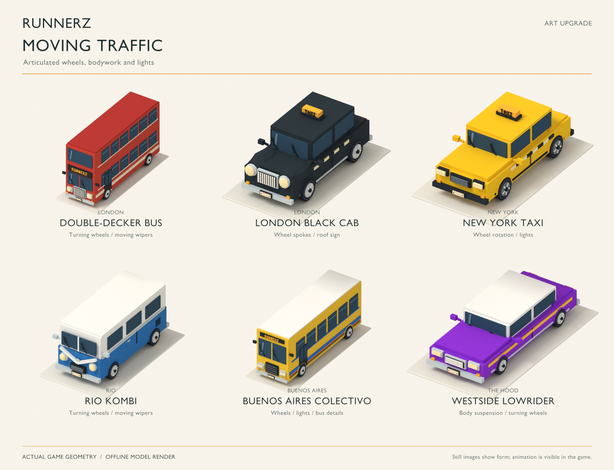
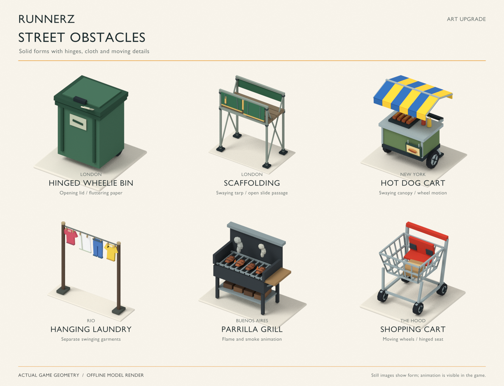
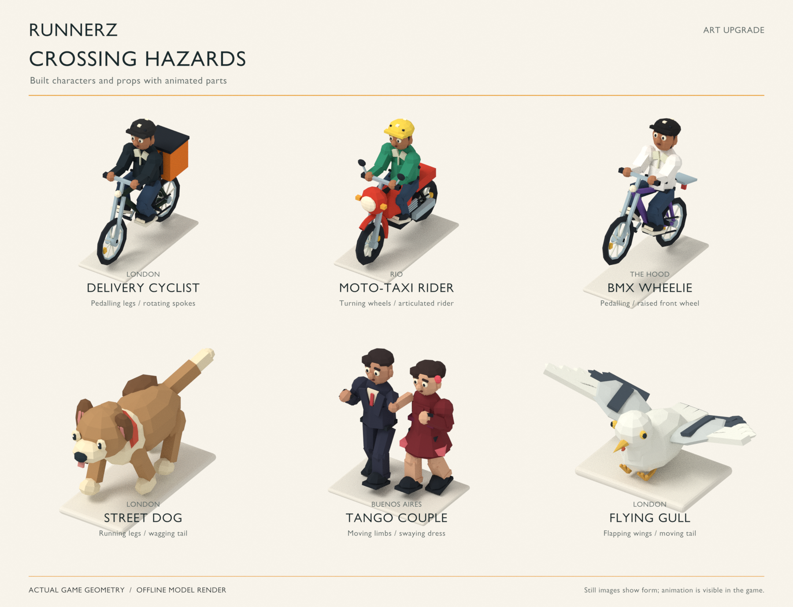

# Runnerz upgrade renders

**[See the tango dancer obstacle in the street →](https://raw.githack.com/jackespana91/RunnerSeries/codex/runnerz-art-preview/Runnerz-In-Game.html?city=buenosaires&artPreview=tango)**

This dedicated preview repeats the animated crossing without starting a round.

**Buenos Aires has a newer in-game art pass:**
[La Boca](https://raw.githack.com/jackespana91/RunnerSeries/codex/runnerz-art-preview/Runnerz-In-Game.html?city=buenosaires&demoPreview=1&district=la-boca) · [San Telmo](https://raw.githack.com/jackespana91/RunnerSeries/codex/runnerz-art-preview/Runnerz-In-Game.html?city=buenosaires&demoPreview=1&district=san-telmo) · [La Avenida](https://raw.githack.com/jackespana91/RunnerSeries/codex/runnerz-art-preview/Runnerz-In-Game.html?city=buenosaires&demoPreview=1&district=la-avenida).

The studio boards below show the earlier 3D model pass and predate those Buenos Aires upgrades.

**[See the upgrades in the actual London game →](https://raw.githack.com/jackespana91/RunnerSeries/codex/runnerz-art-preview/Runnerz-In-Game.html?city=london&demoPreview=1)**

The link opens the complete game with the runner and animated 3D obstacles on
the street. It starts ordinary play-money rounds; press AUTO to stop them.
The browser preview has not been visually verified in this session.

These images show the first-pass 3D game models, frozen during
their animation. They were rendered directly from the model geometry with
studio lighting. They are model renders; gameplay camera framing and lighting
are different. Browser screenshots have not been captured for this art pass.

## Vehicles

London's double-decker and black cab, New York's taxi, Rio's Kombi, the Buenos
Aires colectivo and the Westside lowrider. Wheels, wipers, lights and suspension
move in the playable game and the art viewer.

## Street obstacles

Bins, scaffolding, hot dog carts, laundry, grills and shopping carts now have
solid geometry and independently moving parts.

## Crossing hazards

Cyclists, motorbike riders, the BMX wheelie, a running dog, tango dancers and a
flapping gull use articulated models.

## See them move

Download [Runnerz-Playable-Demo.zip](Runnerz-Playable-Demo.zip?raw=1), extract it,
and open `Runnerz-Art-Preview.html` to rotate and inspect every model, or
`Runnerz-Demo.html` to play.
