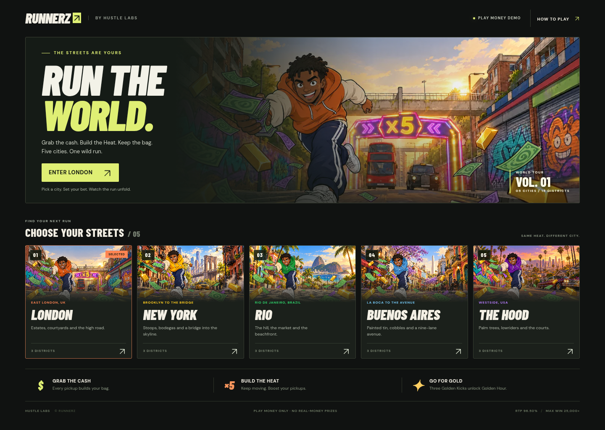

# Runnerz — animated 3D artwork preview

All 35 lane obstacles and seven additional traffic models now use animated 3D
geometry across the five cities. Crossing riders, animals, carts, balls and
wipeout/robbery hazards also have moving model parts.

## View the new artwork and play

1. Download [Runnerz-Playable-Demo.zip](Runnerz-Playable-Demo.zip?raw=1).
2. Extract the ZIP on your computer.
3. Open **`Runnerz-Art-Preview.html`** in Chrome, Edge, Firefox or Safari to
   inspect each model. Choose a city and category, drag to rotate, scroll or
   pinch to zoom, and pause the animation for a closer look.
4. Open **`Runnerz-Demo.html`** to play. Choose a city and press **RUN**.

Both files work offline. The art viewer opens on London's animated double-decker.
Look for turning wheels, hinged bin lids, swaying cloth, warning lights,
lowrider suspension, pedalling riders, running animals and flapping wings.

This is a play-money demo and an initial 3D art pass. The supplied runner and
background pedestrian images remain in use; environment artwork is still in
progress. Supplied Higgsfield art is preserved as reference. No Magnific
processing has been applied.

**Build status:** the game and art viewer compiled successfully on 10 October
2026. The latest 3D changes have not had a browser playthrough or phone
performance check.

## Source

Download [Runnerz-Polished-Source.zip](Runnerz-Polished-Source.zip?raw=1) for the
updated game, model factories, art viewer and development documentation.
[SHA256SUMS.txt](SHA256SUMS.txt) lists both archive checksums. Supplied maths and
payouts are unchanged; original Parts 2 and 3 still provide the publishing books.

The ZIP includes third-party notices and start instructions. GitHub's code
viewer does not run HTML games: download and extract the ZIP first.

## City-selection screen

This existing lobby screenshot shows the city covers. Use the art viewer above
to see the new animated models.

